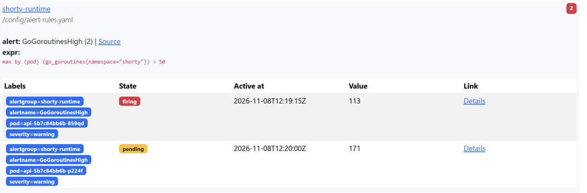
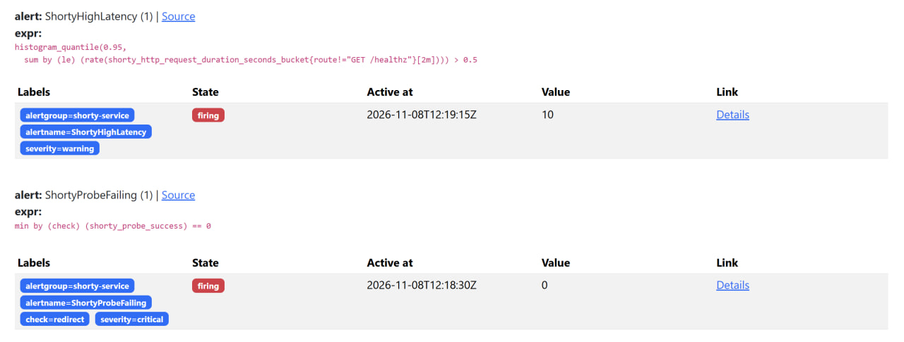
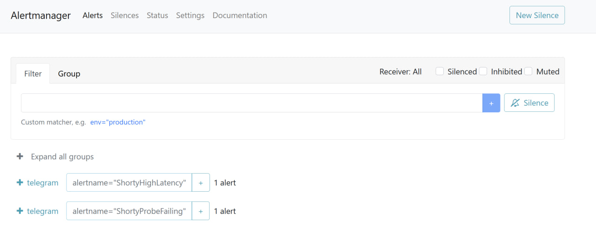
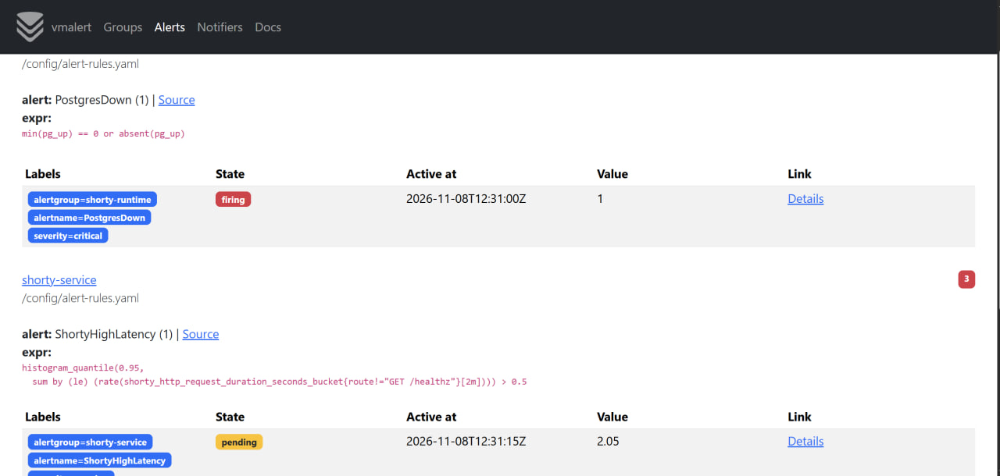
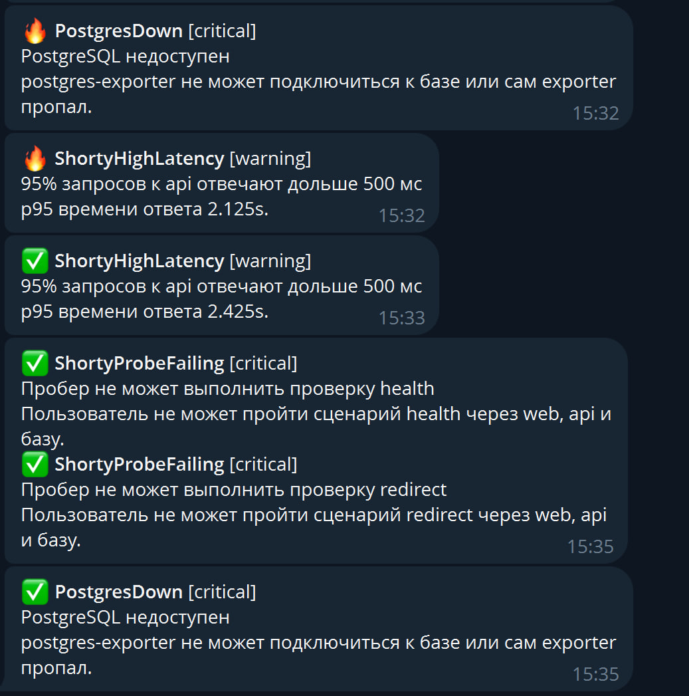

# Отчет: алерты shorty

## Что развернуто

| Компонент | Что делает |
|---|---|
| vmalert | каждые 15 секунд выполняет правила в VictoriaMetrics, при срабатывании отправляет алерт в Alertmanager |
| Alertmanager | группирует алерты и отправляет уведомление в Telegram |
| Telegram-бот | получатель уведомлений |

Оба компонента ставятся одним Helm-чартом `vm/victoria-metrics-alert` в namespace `monitoring`, рядом с VictoriaMetrics из прошлых заданий.

| Файл | Что внутри |
|---|---|
| `k8s/alerting/vm-alert-values.yaml` | правила алертов и настройки чарта |
| `k8s/alerting/alertmanager-secret.yaml` | конфигурация Alertmanager: маршрут, получатель Telegram, шаблон сообщения |
| `k8s/alerting/demo.sh` | команды, которые вызывают сбои для демонстрации |

```bash
helm repo update
kubectl apply -f k8s/alerting/alertmanager-secret.yaml
helm install vm-alert vm/victoria-metrics-alert -n monitoring -f k8s/alerting/vm-alert-values.yaml
```

Конфигурация Alertmanager лежит в Secret, потому что содержит токен бота. Перед применением в `alertmanager-secret.yaml` нужно заменить `bot_token` и `chat_id` на свои значения. Настоящий токен в git не коммитится.

## Какие алерты нужны и почему

Алерт должен сообщать о проблеме, на которую человек может отреагировать. Поэтому за основу взяты те же четыре вещи, что и в SLO: ошибки, скорость, база, доступность для пользователя. Плюс отдельная группа про рантайм Go. Все алерты с `for`: он отсекает короткие всплески, чтобы дежурного не будили из-за одной неудачной секунды.

Запросы `GET /healthz` исключены, их каждые 5 секунд шлет Kubernetes, и они не отражают опыт пользователей.

### Метрики сервиса

| Алерт | Условие | for | Серьезность | Почему |
|---|---|---|---|---|
| `ShortyHighErrorRate` | доля ответов 5xx больше 5% (`shorty_http_requests_total`) | 1m | critical | пользователи получают ошибки. Порог 5% выше случайных единичных сбоев и ниже уровня, когда сервис уже непригоден |
| `ShortyHighLatency` | p95 времени ответа больше 500 мс (`shorty_http_request_duration_seconds`) | 1m | warning | сервис работает, но медленно. Это предупреждение: время на реакцию есть. Нормальные ответы занимают единицы миллисекунд |
| `ShortyProbeFailing` | `shorty_probe_success == 0` по любой проверке пробера | 30s | critical | сценарий не проходит глазами пользователя: web, api, база. Ловит и то, что метрики api не видят: когда поды выведены из балансировки, ошибки отдает nginx |
| `ShortyLoginFailures` | больше 20 неудачных входов за 5 минут (`shorty_logins_total{result="failure"}`) | 1m | warning | бизнес-метрика: массовые неверные пароли похожи на подбор. Это сигнал для внимания, а не для ночной тревоги |

### Метрики рантайма Go и инфраструктуры

| Алерт | Условие | for | Серьезность | Почему |
|---|---|---|---|---|
| `GoGoroutinesHigh` | `go_goroutines` пода больше 50 | 1m | warning | у api обычно 10-20 горутин. Рост означает утечку или запросы, которые зависли и не заканчиваются. Это признак проблемы раньше, чем упадет память |
| `GoMemoryHigh` | `process_resident_memory_bytes` больше 100 MiB | 2m | warning | лимит контейнера 128 MiB. Приближение к нему значит, что скоро контейнер убьет OOM-killer, а `for: 2m` не реагирует на кратковременный пик |
| `TargetDown` | `up == 0` для подов из `kubernetes-pods` | 1m | critical | VictoriaMetrics не может собрать метрики: под упал или завис. Без метрик остальные алерты слепы |
| `PostgresDown` | `pg_up == 0` или метрика `pg_up` пропала | 1m | critical | без базы не работает почти все. Условие `absent(pg_up)` нужно потому, что когда под базы остановлен, пропадает и exporter, а `pg_up` просто перестает приходить |

Серьезность `critical` означает «действовать сейчас», `warning` означает «посмотреть в рабочее время».

## Уведомление

Alertmanager отправляет сообщение в Telegram:

- `group_by: [alertname]`: одинаковые алерты объединяются в одно сообщение;
- `group_wait: 10s`: небольшая пауза, чтобы собрать связанные алерты в одно сообщение;
- `repeat_interval: 1h`: пока алерт не исчез, напоминание раз в час, а не каждую минуту;
- `send_resolved: true`: когда проблема ушла, приходит сообщение ✅.

Формат сообщения: значок, название алерта, серьезность, краткое описание и подробности со значением метрики.

## Как показать срабатывание

Нужна нагрузка, иначе метрик запросов не будет: в отдельном терминале `./k8s/slo/load.sh`.

```bash
kubectl -n monitoring port-forward svc/vm-alert-victoria-metrics-alert-alertmanager 9093:9093
kubectl -n monitoring port-forward svc/vm-alert-victoria-metrics-alert-server 8880:8880
```

| Сценарий | Команда | Какие алерты сработают |
|---|---|---|
| Ошибки | `./k8s/alerting/demo.sh errors` | `ShortyHighErrorRate`, затем `ShortyProbeFailing` |
| Зависшие запросы (рантайм) | `./k8s/alerting/demo.sh goroutines` | `GoGoroutinesHigh`, а также `ShortyHighLatency` и `ShortyProbeFailing` |
| База | `./k8s/alerting/demo.sh db` | `TargetDown`, `PostgresDown`, `ShortyProbeFailing` |
| Вернуть как было | `./k8s/alerting/demo.sh reset` | через минуту приходят сообщения ✅ |

Что смотреть:

- состояние правил: `http://localhost:8880`, вкладка Alerts. Сначала `pending` (условие выполнено, ждем `for`), затем `firing`;
- активные алерты: `http://localhost:9093`;
- сообщения в Telegram.

Сценарий `goroutines` включает искусственную задержку 20 секунд и держит 150 зависших запросов: на репликах api получается 100-170 горутин вместо обычных 15. Он же показывает, что алерт на рантайм срабатывает раньше, чем заканчивается память: упавшего сервиса еще нет, но уже видно, что с ним неладно.

## Результаты

Все алерты проверены на кластере minikube с включенным сбоем. Время в Telegram московское, во vmalert UTC (разница 3 часа).

### Рантайм Go: `GoGoroutinesHigh`

Сценарий `demo.sh goroutines`. Алерт стоит на каждый под отдельно: у одной реплики api было 113 горутин и алерт уже `firing` (с 12:19:15), у второй 171 горутина и алерт еще `pending`, потому что `for: 1m` не выдержан. Порог 50 превышен в 2-3 раза.



### Метрики сервиса: `ShortyHighLatency` и `ShortyProbeFailing`

В этом же сценарии api отвечает с задержкой 20 секунд. `ShortyHighLatency` в состоянии `firing`, p95 равно 10 секундам (верхний бакет гистограммы). `ShortyProbeFailing` по проверке `redirect` сработал на минуту раньше, в 12:18:30: пробер ждет ответ только 2 секунды, поэтому замечает проблему первым.



### Alertmanager

Алерты дошли до Alertmanager и сгруппированы по имени (`group_by: [alertname]`), получатель у обеих групп `telegram`.



### База: `PostgresDown`

Сценарий `demo.sh db`: под postgres остановлен, вместе с ним пропал exporter, и метрика `pg_up` перестала приходить. Правило `min(pg_up) == 0 or absent(pg_up)` сработало именно по `absent`: значение алерта 1. `ShortyHighLatency` в это время в состоянии `pending`, p95 равно 2.05 секунды.



### Уведомления в Telegram

В 15:32 пришли `PostgresDown` и `ShortyHighLatency` с подставленным значением метрики (p95 2.125 с). После `demo.sh reset` пришли сообщения о восстановлении ✅: `ShortyHighLatency` в 15:33, `ShortyProbeFailing` по проверкам `health` и `redirect` и `PostgresDown` в 15:35. Два алерта с одним именем объединены в одно сообщение, это работа `group_by`.



## Выводы

- Пробер срабатывает первым: он ловит проблему за 30 секунд, а алерты по метрикам ждут минуту накопления данных. Поэтому он нужен как отдельный алерт.
- Алерт на горутины заметил проблему по рантайму, когда метрики запросов еще росли только по задержке: рост числа горутин показывает зависшие запросы.
- `for` убирает ложные срабатывания: `PostgresDown` и `GoGoroutinesHigh` сначала `pending` и только через минуту `firing`.
- Сообщения о восстановлении приходят автоматически (`send_resolved: true`), закрывать алерт вручную не нужно.
