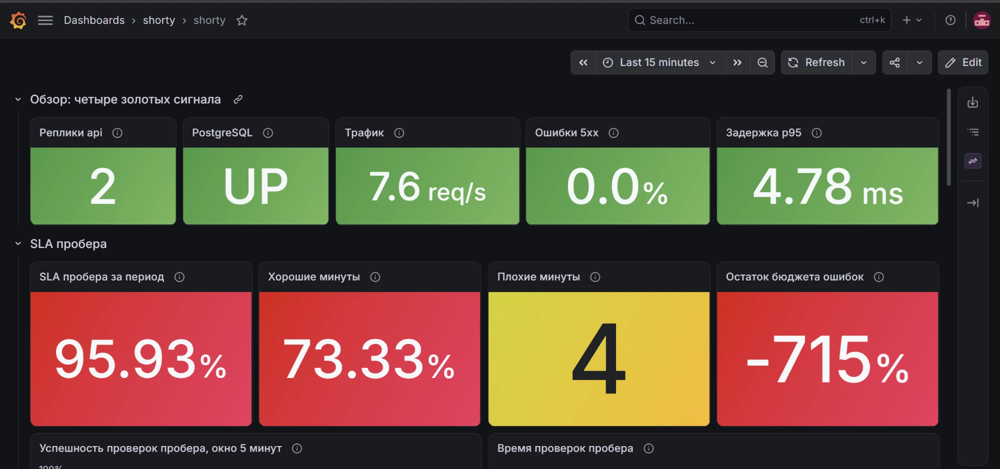
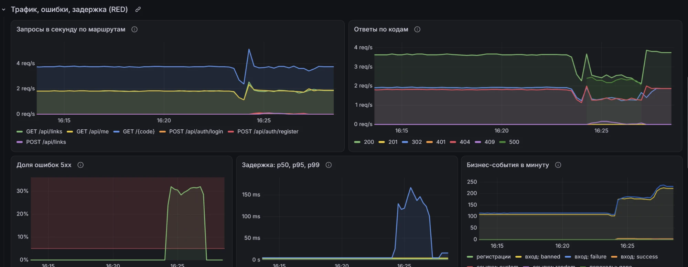
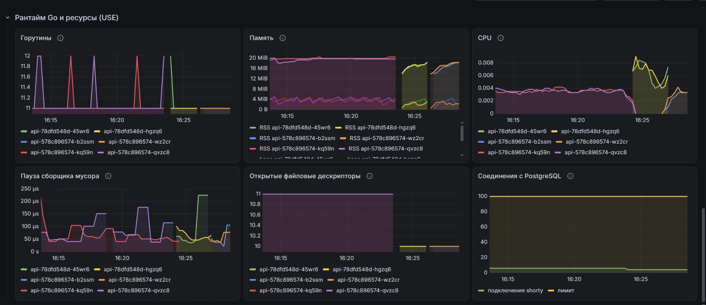
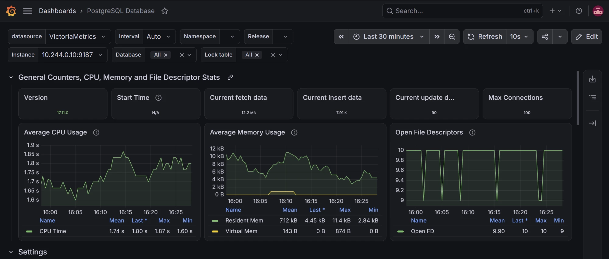

# Отчет: дашборды shorty в Grafana

## Что развернуто

| Компонент | Как | Где |
|---|---|---|
| Grafana 13.3.1 | Helm-чарт `grafana-community/grafana` | namespace `monitoring` |
| Источник данных VictoriaMetrics | провиженинг из values, тип `prometheus` | `http://vm-single-victoria-metrics-single-server.monitoring:8428` |
| Дашборд shorty | провиженинг из values, JSON в `k8s/grafana/shorty-dashboard.json` | папка `shorty` в Grafana |
| Дашборд PostgreSQL Exporter | импорт в интерфейсе по ID 9628 с grafana.com | папка `General` |

```bash
helm repo add grafana-community https://grafana-community.github.io/helm-charts
helm repo update
helm install grafana grafana-community/grafana -n monitoring \
  -f k8s/grafana/grafana-values.yaml \
  --set-file dashboards.shorty.shorty.json=k8s/grafana/shorty-dashboard.json
kubectl port-forward svc/grafana 3000:80 -n monitoring
```

Grafana открывается на `http://localhost:3000`, логин `admin`, пароль `admin`.

### Источник данных

VictoriaMetrics совместима с API Prometheus, поэтому подключена встроенным типом источника `prometheus`, без отдельного плагина. Источник создается при старте Grafana из `grafana-values.yaml` с фиксированным `uid: victoriametrics`. На этот `uid` ссылаются все панели в JSON дашборда, поэтому дашборд работает сразу после установки, без ручного выбора источника.

Других источников не нужно: метрики приложения, пробера, рантайма Go и postgres-exporter собирает одна VictoriaMetrics по аннотациям `prometheus.io/*` из прошлых заданий.

### Почему дашборд в values, а не создан руками

Дашборд хранится в git как JSON и подключается через `--set-file`: чарт кладет его в ConfigMap и монтирует в Grafana. Дашборд воспроизводится одной командой и не теряется при пересоздании пода. Экспорт из интерфейса (Share, Export, Save to file) дает этот же JSON.

## Дашборд shorty

Дашборд разбит на четыре блока: сверху самое важное, ниже детали. Так сначала видно, есть ли проблема, а потом где она.

Скриншоты сделаны в minikube под нагрузкой `load.sh`. Около 16:23 на 3 минуты был включен сбой `FAULT_ERROR_RATE=0.3` (api отвечает 500 на 30% запросов), чтобы показать реакцию панелей.

### 1. Обзор: четыре золотых сигнала

Пять крупных цифр, которые за секунду отвечают на вопрос «все ли в порядке». Цвет фона меняется по порогам, совпадающим с порогами алертов.

| Панель | Метрика | Сигнал | Пороги |
|---|---|---|---|
| Реплики api | `sum(up{container="api"})` | статус | 2 зеленый, 1 оранжевый, 0 красный |
| PostgreSQL | `max(pg_up)` | статус | UP или DOWN. Пустое значение тоже DOWN: когда под базы удален, пропадает и экспортер |
| Трафик | `rate(shorty_http_requests_total)` | Traffic | |
| Ошибки 5xx | доля `status=~"5.."` | Errors | 1% желтый, 5% красный (порог алерта) |
| Задержка p95 | `histogram_quantile(0.95, ...)` | Latency | 250 мс желтый, 500 мс красный (порог алерта) |

Четвертый золотой сигнал, Saturation, вынесен в блок рантайма.

На скриншоте сбой уже выключен: обе реплики работают, база UP, 7.6 запроса в секунду, ошибок нет, p95 равно 4.78 мс. Все плашки зеленые.

### 2. SLA пробера

Отдельный блок с подсчетом SLA по данным пробера (`shorty_probe_total`). Пробер каждые 10 секунд проходит сценарий пользователя через web, api и базу, поэтому его SLA показывает доступность сервиса глазами пользователя.

Все четыре цифры считаются за период, выбранный в Grafana справа сверху: переменная `$__range` подставляет длину периода в запрос. Выбрали «последние 24 часа», получили SLA за сутки.

| Панель | Формула | Пороги |
|---|---|---|
| SLA пробера за период | успешные проверки / все проверки | ниже 99% (SLA) красный, ниже 99.5% (SLO) желтый, выше зеленый |
| Хорошие минуты | доля минут, когда все проверки прошли (time-based SLA) | те же |
| Плохие минуты | число минут с хотя бы одной неудачной проверкой | 1 желтый, 5 красный |
| Остаток бюджета ошибок | `1 - (1 - SLA) / (1 - 0.995)` | меньше 0 красный: SLO нарушен |

```
SLA = sum(increase(shorty_probe_total{result="success"}[$__range]))
    / sum(increase(shorty_probe_total[$__range]))

Хорошие минуты = avg_over_time((sum(increase(shorty_probe_total{result="failure"}[1m])) == bool 0)[$__range:1m])
```



За последние 15 минут сбой оставил след: SLA пробера 95.93% и 73.33% хороших минут, 4 плохие минуты, бюджет ошибок ушел в минус (-715%). Это ниже SLA 99%, поэтому плашки красные. Окно 15 минут короткое, бюджет при SLO 99.5% составляет всего 4.5 секунды, поэтому одна плохая минута уже сильно уводит его в минус.

Под цифрами два графика:

- **Успешность проверок пробера** по каждой проверке (`web`, `health`, `redirect`) в окне 5 минут, с линиями SLA 99% и SLO 99.5%. Видно, какая именно проверка падает.
- **Время проверок пробера**: если проверка начинает работать дольше, это заметно до того, как она упадет по таймауту 2 секунды.

### 3. Трафик, ошибки, задержка (RED)

Метод RED для сервиса, который обрабатывает запросы: Rate, Errors, Duration.

| Панель | Зачем |
|---|---|
| Запросы в секунду по маршрутам | Rate: какие маршруты нагружены. Метка `route` берется из шаблона маршрута, поэтому число рядов не растет с числом ссылок |
| Ответы по кодам | Errors: 2xx и 3xx норма, 4xx ошибки клиента (неверный пароль, нет ссылки), 5xx ошибки сервиса |
| Доля ошибок 5xx | Errors в процентах, с линией порога алерта 5% |
| Задержка p50, p95, p99 | Duration: медиана показывает обычный опыт, p99 показывает худший |
| Бизнес-события в минуту | регистрации, входы по результату, новые ссылки, переходы: работает ли сервис для пользователей, а не только отвечает ли он |

Во всех панелях исключены запросы `GET /healthz`: их шлет Kubernetes, и они не отражают трафик пользователей.



Во время сбоя доля 5xx поднялась примерно до 30% и вышла за линию порога алерта 5%, в «Ответах по кодам» появились коды 500. Всплеск задержки p99 до 160 мс пришелся на перезапуск подов: `kubectl set env` пересоздает поды, и первые запросы к новым подам медленнее.

### 4. Рантайм Go и ресурсы (USE)

Метод USE для ресурсов: Utilization, Saturation, Errors. Метрики отдает `client_golang` из прошлого задания, по каждому поду api отдельно.

| Панель | Метрика | Что показывает |
|---|---|---|
| Горутины | `go_goroutines` | Saturation: зависшие запросы и утечки. Линия на 50 совпадает с порогом алерта |
| Память | `process_resident_memory_bytes`, `go_memstats_heap_alloc_bytes` | Utilization памяти при лимите 128 MiB |
| CPU | `rate(process_cpu_seconds_total)` | Utilization процессора в ядрах при лимите 0.25 |
| Пауза сборщика мусора | `go_gc_duration_seconds` | длинные паузы GC напрямую увеличивают задержку |
| Открытые файловые дескрипторы | `process_open_fds` | растут вместе с числом соединений |
| Соединения с PostgreSQL | `pg_stat_database_numbackends`, `pg_settings_max_connections` | Saturation базы: сколько подключений занято из лимита |



На графиках рантайма видно смену подов: включение и выключение сбоя через `kubectl set env` дважды пересоздало реплики api, поэтому в легенде три поколения подов. Значения в норме: 11-12 горутин, 16-20 MiB RSS при лимите 128 MiB, меньше 0.01 ядра CPU, паузы GC до 250 мкс, около 10 файловых дескрипторов, 5 подключений к базе из 100.

## Дашборд PostgreSQL Exporter

Импортирован готовый дашборд «PostgreSQL Database» с grafana.com, ID 9628: Dashboards, New, Import, ввести 9628, Load, выбрать источник VictoriaMetrics, Import.

Он показывает метрики `postgres-exporter` из прошлого задания: версию, время работы, подключения, транзакции, операции со строками, конфликты и блокировки, размер базы и настройки сервера.



Дашборд работает на том же источнике VictoriaMetrics и сам нашел экземпляр экспортера (`10.244.0.10:9187`, IP пода `postgres-0`). Видны версия PostgreSQL, лимит в 100 подключений, объемы прочитанных и вставленных данных, CPU, память и файловые дескрипторы процесса. Панель Start Time показывает N/A: дашборд рассчитан на старые версии экспортера, и эта метрика в v0.20 называется иначе.
