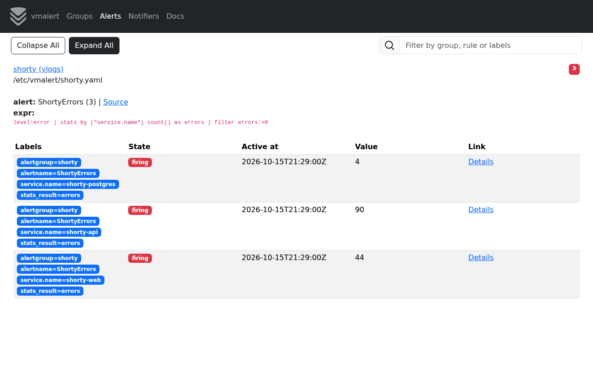

# Отчёт: логи shorty в VictoriaLogs

## Что развёрнуто

| Файл | Что внутри |
|---|---|
| `k8s/logging/victorialogs.yaml` | VictoriaLogs single-node: PVC + Deployment + Service (порт 9428) |
| `k8s/logging/vector.yaml` | Vector: ServiceAccount + RBAC + ConfigMap с конфигом + DaemonSet |
| `k8s/logging/vmalert.yaml` | бонус: vmalert с правилом на LogsQL |

```
Pod api / web / postgres ──stdout──► /var/log/pods/... на узле
                                          │
                                 Vector (DaemonSet) читает файлы,
                                 разбирает JSON, добавляет pod/container
                                          │  POST /insert/elasticsearch/_bulk
                                          ▼
                                 VictoriaLogs ◄── vmalert (раз в минуту)
                                          ▲
                        kubectl port-forward svc/victorialogs 9428
                                          │
                                      браузер (vmui)
```

## Запуск

```bash
kubectl apply -f k8s/logging/
kubectl apply -f k8s/
kubectl get pods

kubectl port-forward svc/victorialogs 9428:9428
# vmui: http://localhost:9428/select/vmui/

kubectl port-forward svc/vmalert 8880:8880
# алерты: http://localhost:8880/vmalert/alerts
```

В VictoriaLogs v1.53 веб-интерфейс открывается по адресу `/select/vmui/`, старый путь `/vmui/` отвечает ошибкой.

## Формат логов

Оба сервиса приложения пишут в stdout по одной JSON-строке на событие. Поля выбраны по чек-листу семинара.

| Поле | Что в нём |
|---|---|
| `timestamp` | время события в RFC 3339 |
| `level` | `info`, `warn`, `error` |
| `message` | текст события |
| `service.name` | `shorty-api` или `shorty-web` |
| `method`, `path`, `status` | HTTP-запрос и ответ |
| `duration_ms` (api), `duration_s` (web) | сколько занял запрос |

Уровень у логов запросов зависит от ответа: 5xx → `error`, 4xx → `warn`, остальное → `info`.

**api** (Go, `log/slog`). Ключи переименованы в `api/main.go`, уровень выставляется в `api/http.go`:

```json
{"timestamp":"2026-10-15T21:28:46.621Z","level":"error","message":"request","service.name":"shorty-api","method":"GET","path":"/healthz","status":503,"duration_ms":0.721}
```

**web** (nginx). JSON-формат access-лога задан через `log_format` в `web/nginx.conf.template`:

```json
{"timestamp":"2026-10-15T21:28:09+00:00","level":"error","message":"GET /go-doc 500","service.name":"shorty-web","method":"GET","path":"/go-doc","status":500,"duration_s":0.003,"bytes":83,"user_agent":"curl/8.5.0"}
```

PostgreSQL и служебные сообщения nginx пишут обычный текст. Vector отправляет их как есть, ставит `service.name` по имени контейнера (`shorty-postgres`) и `level: error`, если в строке встречается `error`, `fatal` или `panic`.

Ко всем записям Vector добавляет `pod`, `container` и `node`. Потоки (`_stream`) в VictoriaLogs разбиты по `service.name` и `pod`.

## Почему Vector в DaemonSet

- **Приложение не знает про систему логов.** Оно просто пишет в stdout, а сбор, разбор и доставка — забота окружения (фактор XI из 12-factor). Чтобы поменять VictoriaLogs на другое хранилище, не нужно трогать код.
- **Один сборщик на узел, а не на каждый под.** DaemonSet запускает ровно один под Vector на ноде, и он читает файлы всех контейнеров из `/var/log/pods`. С сайдкаром пришлось бы добавлять контейнер в каждый Deployment, и при `kubectl scale deployment/api --replicas=4` сборщиков стало бы четыре.
- **Собираются логи всех компонентов**, включая nginx и PostgreSQL, которые сами в VictoriaLogs отправлять не умеют. Прямой push из Go-кода покрыл бы только `api`.
- **Метаданные Kubernetes бесплатно.** Источник `kubernetes_logs` сам узнаёт имя пода, контейнера и узла через API Kubernetes (для этого нужен RBAC в `vector.yaml`).
- **Готовая интеграция.** VictoriaLogs принимает данные по протоколу Elasticsearch bulk, а в Vector для этого есть штатный sink `elasticsearch`. Через query-параметры (`_msg_field`, `_time_field`, `_stream_fields`) сразу указывается, какие поля считать сообщением, временем и потоком.

Vector собирает только поды из namespace `default` и пропускает собственные (`app notin (vector,victorialogs,vmalert)`), чтобы не логировать сам себя. `glob_minimum_cooldown_ms: 5000` заставляет искать новые файлы раз в 5 секунд вместо 60 по умолчанию. Без этого короткоживущие поды (Job `migrate`) могут завершиться и удалиться раньше, чем Vector прочитает их логи.

## LogsQL-запросы

Перед снятием скриншотов я сгенерировал трафик: регистрации, неудачные входы, создание ссылок, переходы по ним с разной популярностью, несуществующие коды. Ещё на полминуты остановил PostgreSQL (`kubectl scale deployment/postgres --replicas=0`), чтобы в логах появились настоящие ошибки.

### (а) Сырые записи за последние 15 минут

```
_time:15m
```

Все записи за 15 минут от всех сервисов, новые сверху. Фильтр `_time:15m` ограничивает время, других условий нет. На гистограмме сверху виден всплеск трафика около 21:28. Во вкладке JSON видно, что каждая запись — разобранный JSON с отдельными полями (`level`, `method`, `path`, `status`, `duration_ms`, `pod`), а не одна строка текста.


### (б) Фильтр по полям: ошибки api

```
_time:15m "service.name":"shorty-api" level:error
```

Только записи с `level:error` от сервиса `shorty-api`. Имя поля `service.name` взято в кавычки, потому что в нём есть точка. Все 90 найденных ошибок пришлись на те полминуты, когда PostgreSQL был остановлен: `/healthz` отвечал 503, а обычные запросы — 500 с сообщением `internal error`. По гистограмме видно, когда начался и закончился сбой.


### (в) `stats` с группировкой: сколько логов у какого сервиса и уровня

```
_time:15m | stats by ("service.name", level) count() as logs | sort by (logs desc)
```

Пайп `stats by (...)` группирует записи по паре «сервис + уровень» и считает количество в каждой группе, `sort` упорядочивает по убыванию. Так за один запрос видно, кто сколько пишет и где ошибки: 90 ошибок у `shorty-api`, 44 у `shorty-web` (nginx отдавал клиентам те же 500) и 4 у `shorty-postgres`. Последние — настоящие `ERROR` из самой базы: попытка зарегистрировать уже существующий email и создать занятый алиас (нарушение `UNIQUE`).


### (г) `top`: самые популярные короткие ссылки

```
_time:15m "service.name":"shorty-api" status:302 | top 5 by (path)
```

Ответ `302` — это успешный редирект по короткой ссылке, а `path` — её код. Пайп `top 5 by (path)` возвращает пять самых частых значений поля с числом вхождений. Получается рейтинг ссылок по переходам прямо из логов: `/go-doc` (88), `/k8s` (50), `/habr` (28), `/vlogs` (18), `/cv-pdf` (12). Это совпадает с тем, сколько переходов я генерировал.


### (д) Дополнительно: `quantile` — время ответа по путям

```
_time:15m "service.name":"shorty-api" _msg:request
  | stats by (path) count() as hits, quantile(0.95, duration_ms) as p95_ms
  | sort by (hits desc) | limit 8
```

Для каждого пути считается число запросов и 95-й перцентиль времени ответа. `_msg:request` оставляет только логи HTTP-запросов (поле `message` при приёме становится `_msg`). Видно, что обычный редирект занимает около 1 мс, а у `/go-doc` и `/api/links` p95 около 1 секунды. Именно эти пути я дёргал во время остановки базы, и запросы ждали подключения к PostgreSQL. Такой запрос сразу показывает, какие эндпоинты пострадали от сбоя.


## Бонус: алерт через vmalert

`vmalert.yaml` запускает vmalert, который раз в минуту выполняет LogsQL-запрос к VictoriaLogs. Запрос построен по образцу запроса (в), только без группировки по уровню:

```yaml
- alert: ShortyErrors
  expr: 'level:error | stats by ("service.name") count() as errors | filter errors:>0'
  annotations:
    summary: '{{ index $labels "service.name" }}: {{ $value }} ошибок за последнюю минуту'
```

Если за минуту у сервиса есть хотя бы одна ошибка, загорается алерт с меткой `service.name`. Отдельный алерт на каждый сервис получается благодаря группировке в `stats by`. Получателя уведомлений (Alertmanager) нет (`-notifier.blackhole`), поэтому алерты видны только в веб-интерфейсе vmalert. На скриншоте — три сработавших алерта во время остановки базы.


